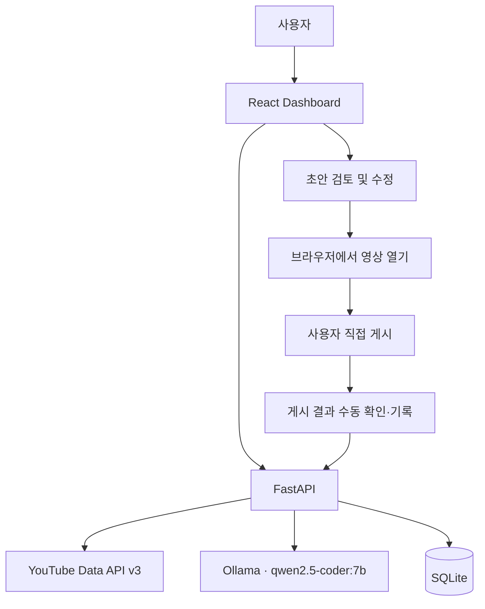

# Marketing AI Agent — 개발 기획서

> (주)제이지그룹 AI PM 선발 과제 · TRACK 2 기반  
> 개발 방식: Windows 로컬 실행 · Codex 활용 · Ollama 로컬 LLM  
> 문서 상태: **구현 전 기획** (기능 구현·E2E 검증 완료 아님)

## 1. 프로젝트 개요

### 1.1 목적

지정된 YouTube 채널의 영상 목록을 불러오고, 영상별 연애 고민과 근거를 분석한 후, 마케팅 댓글 **초안**을 생성·검토할 수 있는 로컬 대시보드를 개발합니다. 사용자가 게시 여부를 결정하며, 검토 및 작업 결과는 로컬에 기록합니다.

주요 사용자 흐름은 **영상 수집 → 영상 선택 → 맥락 분석 → 댓글 초안 생성 → 사용자 검토·수정 → 브라우저에서 수동 게시 → 작업 기록**입니다.

### 1.2 과제 원문과 실제 구현 범위의 차이

원문 과제는 일반 시청자처럼 보이는 홍보 댓글을 여러 Chrome 계정으로 자동 입력·게시·확인하는 흐름을 요구합니다. 본 프로젝트는 **광고·홍보 관계를 투명하게 표시한 초안**을 생성하고, **사용자 검토 후 직접 게시**하는 방식으로 범위를 조정합니다.

- 구현: 영상 조회, AI 맥락 분석, 댓글 초안 생성·수정, 운영 제한, Chrome 영상 열기, 작업 결과 기록
- 제외: 일반 시청자 위장, 허위 이용 후기, 다중 계정 순환 게시, 자동 타이핑·자동 게시
- 영향: 과제 원문의 **자동 게시 관련 필수 요구사항을 그대로 충족하지 못하므로**, 해당 평가 항목에서 감점될 수 있습니다.

이 차이는 README 및 제출용 제작 의도에서도 숨기지 않습니다.

## 2. 과제 기준과 우선순위

| 평가 항목 | 배점 | 구현 방향 |
|---|---:|---|
| 실제 게시 | 25 | Chrome에서 영상 열기, 수동 게시 및 결과 기록. **원문의 자동 게시 방식과 다름** |
| 맥락 이해 | 25 | 영상 내용의 고민과 실제 근거 추출, 근거 없는 장면·발언 생성 방지 |
| 브랜드 유도 | 20 | `운명원` 언급을 포함하되 홍보 관계를 표시한 댓글 초안 |
| 운영 규칙 | 15 | 지정 채널·테스트 영상 제한, 앱 내 중복 방지, 일일 작업 상한, 기록 |
| 사용성 | 10 | 영상 목록–AI 분석–댓글 검토의 명확한 사용 흐름 |
| 제작 의도 | 5 | 구조 선택, 검증 방식, 제약과 설계 차이를 설명 |
| 가점 | 별도 | 직접 링크 입력, 새 영상 즉석 분석은 기본 흐름 검증 후 검토 |

점수는 과제 문서의 배점을 옮긴 것이며, 실제 획득 점수를 의미하지 않습니다.

## 3. 사용자 및 실행 환경

- **대상:** Windows PC에서 직접 프로그램을 실행하고 댓글 내용을 검토하는 단일 사용자
- **실행:** 로컬 React 대시보드 + FastAPI 서버 + Ollama 서버
- **배포:** 외부 공개 서버 및 클라우드 인프라 불필요
- **설정:** API 키, Ollama 주소·모델, 작업 제한을 `.env` 및 서버 설정으로 관리
- **계정:** 사용자의 기존 Chrome 계정을 자동 제어하지 않음. 수동 게시에 사용할 영상 페이지를 브라우저에서 열기

## 4. 기술 스택

| 영역 | 기술 | 담당 역할 |
|---|---|---|
| Frontend | React + TypeScript + Vite | 대시보드, 검색·필터, 상태 표시, 댓글 편집 |
| Backend | Python + FastAPI | API 제공, 데이터 수집 오케스트레이션, AI 호출, 운영 규칙 |
| Local LLM | Ollama `qwen2.5-coder:7b` | 연애 고민 분석, 근거 정리, 댓글 초안 생성 |
| YouTube | YouTube Data API v3 | 채널·영상 메타데이터, 접근 가능한 댓글 수집 |
| Database | SQLite | 영상 처리 결과, 댓글 초안, 작업 이력·상태 저장 |
| Browser | Playwright 또는 일반 브라우저 열기 | 로컬 브라우저 확인 흐름, E2E 테스트 지원 |
| E2E | Playwright Test | 사용자 관점의 화면·API 연계 검증 |
| Configuration | `.env` | 비밀 값 및 모델 연결 설정 |

**사용하지 않는 기술:** OpenAI API(기본 구성에서 제외), `qwen3-embedding:0.6b`, 벡터 DB, RAG, Redis, PostgreSQL, Celery, MCP, Multi-Agent 프레임워크.

`qwen2.5-coder:7b`는 코드 특화 모델이므로 한국어 마케팅 문장 품질을 보장하지 않습니다. 실영상 비교 검증 전까지 모델 적합성은 **미확인**으로 취급합니다. 결과가 부족할 때만 다른 Ollama 생성 모델을 비교합니다.

### 4.1 환경 변수 초안

```dotenv
YOUTUBE_API_KEY=
OLLAMA_BASE_URL=http://localhost:11434
OLLAMA_MODEL=qwen2.5-coder:7b
DATABASE_URL=sqlite:///./data/marketing-agent.db
DAILY_MAX_COMMENTS=10
```

`DAILY_MAX_COMMENTS`는 앱 내부에서 관리하는 게시 작업 기록·확인 횟수의 상한입니다. YouTube 전체 계정 활동을 강제 통제한다는 의미가 아닙니다.

## 5. 시스템 구조



- 영상 수집과 AI 추론을 분리합니다.
- AI는 콘텐츠 분석과 초안 생성만 담당합니다. 채널 허용 여부·길이·중복·작업 상한은 백엔드 코드로 검증합니다.
- YouTube 페이지에 실제 댓글이 게시되었다는 사실은 외부에서 확인 가능한 근거가 있는 경우에만 `확인 완료`로 표시합니다. 사용자 표시만 있는 경우 `사용자 확인`으로 구분합니다.

## 6. 기능 요구사항

### 6.1 영상 불러오기

**대상 채널 (과제 지정)**

| 채널 | YouTube 채널 ID |
|---|---|
| 외롭여 | `UCxlc0Ky0aWoD8uI09ad44Tg` |
| 리즈시절 LizTV | `UC-ee_ziASM251TMXe3P3VZA` |
| 러브커넥트 유지연 | `UC09L3JxGVcn7SKLa-pjTEmw` |
| 연애데이터 노노 | `UCVdtDW-HF4KluixGaBAcI4w` |
| 심리조각 | `UCkGl2jieOVhGiHPdXF77Yyw` |

**동작**

1. 사용자가 `영상 불러오기` 버튼을 누릅니다.
2. 서버가 지정 채널의 최신 영상 목록을 조회합니다.
3. 화면에 썸네일·제목·채널·업로드 날짜를 표시합니다.
4. 채널 필터·제목 검색·영상 선택을 지원합니다.
5. API 오류나 목록 없음 상태를 분리하여 안내하고, 불필요한 호출은 캐시로 줄입니다.

**완료 기준:** 실제 YouTube 데이터로 5개 채널 목록이 조회되고, 영상 선택 시 상세 패널이 변경됩니다.

### 6.2 영상 맥락 분석

입력 우선순위는 **적법하게 접근 가능한 자막 → 제목·설명 → 접근 가능한 공개 댓글**입니다. 서로 다른 자료의 출처를 구분하여 LLM에 전달합니다.

YouTube Data API만으로 임의의 타인 영상 자막 원문을 다운로드할 수 있다고 전제하지 않습니다. 자막 미확보 시 실제 장면·발언의 인용은 생성하지 않으며, 화면에 `자막 없음 / 메타데이터 기반`이라고 표시합니다.

AI 응답 필드:

| 필드 | 의미 |
|---|---|
| `concern` | 영상의 핵심 연애 고민 한 문장 |
| `evidence` | 실제 입력 자료에서 확인한 구체적 근거 |
| `source_type` | `caption`, `description`, `title`, `comment` 등 |
| `limitations` | 자막 부재·정보 부족 등 분석 한계 |
| `confidence_note` | 근거 수준에 대한 짧은 설명(확률 수치 아님) |

**완료 기준:** 서로 다른 실제 영상에서 근거가 있는 분석을 생성하고, 입력에 없는 발언·장면을 사실처럼 작성하지 않습니다.

### 6.3 댓글 초안 생성 및 편집

- AI 분석 결과를 토대로 `운명원`과 관련된 **홍보 관계 명시형** 댓글 초안을 작성합니다.
- 길이: **40~120자**, 공백 포함 기준으로 통일합니다.
- 금지: URL, 해시태그, 허위 직접 이용 후기, 근거 없는 장면·발언, 시청자 위장 표현
- 동일한 문구를 반복 사용하지 않도록 초안 비교를 지원하되, 자동으로 품질을 보장한다고 주장하지 않습니다.
- 사용자가 초안을 수정·재생성할 수 있으며, 검증 오류가 있으면 게시 검토 진행을 막습니다.
- 초안 생성·수정·검토 기록을 남깁니다.

**완료 기준:** 글자 수·금지 표현을 검증하고, 사용자가 수정한 내용이 저장·복원됩니다.

### 6.4 운영 규칙 및 작업 이력

- 지정 5개 채널과 사용자가 소유·관리하는 테스트 영상만 작업 대상으로 허용합니다.
- URL 직접 입력 시 영상 ID 파싱 후 **실제 채널 ID를 조회해 허용 여부를 판정**합니다.
- 앱에서 한 영상의 게시 작업을 중복 완료 처리하지 않도록 제한합니다.
- 하루 최대 작업 건수는 기본 10건으로 설정합니다.
- 작업 상태는 `draft`, `reviewed`, `opened`, `user_confirmed`, `verified`, `failed` 등으로 구분합니다. 실제 검증 근거 없이 `verified`를 자동 부여하지 않습니다.
- 작업 시각, 영상 ID, 작성한 댓글, 상태, 오류 내용 등을 시간순으로 확인합니다.
- 서버 재시작 이후에도 SQLite에 기록이 남아야 합니다.

**완료 기준:** 허용되지 않은 링크·중복 처리·일일 상한 초과가 차단되고, 이력이 재시작 후에도 유지됩니다.

### 6.5 브라우저 및 게시 확인

1. 검토된 초안에서 `YouTube에서 열기`를 누릅니다.
2. 선택한 영상이 브라우저에서 열립니다.
3. 사용자가 댓글을 직접 게시합니다.
4. 사용자가 결과를 확인하고 대시보드에서 게시 여부를 기록합니다.
5. 오류 발생 시 에러 메시지·시점·가능한 범위의 화면 캡처를 남깁니다.

**완료 기준:** 본인 테스트 영상 기준 `영상 선택 → 초안 검토 → 영상 열기 → 직접 게시 → 결과 기록` 흐름을 재현합니다.

> 원문에 있는 `Chrome 프로필 자동 실행 → 한 글자씩 자동 타이핑 → 자동 게시 → 자동 확인`은 이번 설계의 구현 범위가 아닙니다.

## 7. 대시보드 디자인

### 7.1 디자인 방향

최근 확정한 **HelpNest 스타일의 밝은 SaaS 업무 대시보드**를 기준으로 합니다.

- 밝은 화이트·라이트 블루·쿨 그레이 중심
- 얇은 경계선, 낮은 강도의 그림자, 간결한 상태 배지
- 긴 설명문보다 정보 밀도·가독성·상태 구분 우선
- 불필요한 애니메이션·영상 히어로·과장된 그래픽 제외

### 7.2 화면 구조

| 영역 | 구성 | 역할 |
|---|---|---|
| 좌측 고정 사이드바 | 대시보드, 영상 목록, 작업 이력, 설정 | 주요 내비게이션 |
| 중앙 메인 패널 | 검색, 채널 필터, 영상 목록, 영상 선택 | 대상 탐색 |
| 우측 상세 패널 | 영상 정보, AI 고민·근거, 댓글 편집, 검토 상태 | 핵심 작업 |
| 이력 영역 | 작업 시간, 영상, 댓글, 상태, 오류 | 실행 추적 |

이전의 균등한 3열 카드 배치 대신, **사이드바 + 넓은 목록 + 상세 작업 패널**을 최종 기준으로 사용합니다. 작업 이력은 화면 크기에 따라 별도 뷰 또는 목록 하단에 배치합니다.

**화면 상태:** 로딩 / 데이터 없음 / 영상 선택 전 / 분석 중 / 분석 실패 / 초안 생성 완료 / 검토 완료 / 기록 완료.

**반응형:** 데스크톱을 우선 설계하고, 좁은 화면에서는 패널을 세로 배치하거나 상세 패널을 독립 화면으로 전환합니다. 가로 넘침 없이 영상 선택·댓글 편집을 수행할 수 있어야 합니다.

### 7.3 기본 사용자 흐름

```text
[영상 불러오기]
       ↓
[채널 필터 / 영상 선택]
       ↓
[AI 분석 및 근거 확인]
       ↓
[댓글 초안 생성 / 수정]
       ↓
[검증 통과 및 사용자 검토]
       ↓
[YouTube 영상 열기]
       ↓
[사용자 직접 게시]
       ↓
[결과 확인 / 작업 이력 기록]
```

HTML 디자인 시안은 구현 참고 자료일 뿐 실제 API·Ollama 연동이 완료되었다는 의미가 아닙니다.

## 8. 데이터 및 API 설계 기준

### 8.1 최소 데이터 구조

| 데이터 | 필수 정보 |
|---|---|
| `videos` | 영상 ID, 채널 ID, 제목, 업로드 날짜, 썸네일, 수집 시각 |
| `analyses` | 영상 ID, 고민, 근거, 출처 종류, 한계, 분석 모델, 분석 시각 |
| `comment_drafts` | 영상 ID, 초안 본문, 수정 본문, 검증 상태, 작성·수정 시각 |
| `activity_logs` | 영상 ID, 작업 종류, 상태, 댓글 본문, 오류 정보, 작업 시각 |

테이블명·세부 컬럼은 구현 시 실제 조회·저장 흐름에 맞춰 최소화합니다. 동일한 데이터를 여러 테이블에 중복 보관하지 않습니다.

### 8.2 API 후보

| Method | Path | 기능 |
|---|---|---|
| `GET` | `/api/videos` | 지정 채널 영상 조회 및 목록 반환 |
| `POST` | `/api/videos/resolve` | 입력 URL의 영상·채널 검증 |
| `POST` | `/api/videos/{video_id}/analyze` | Ollama 영상 맥락 분석 |
| `POST` | `/api/videos/{video_id}/draft` | 댓글 초안 생성 |
| `PUT` | `/api/drafts/{draft_id}` | 댓글 수정·검토 상태 저장 |
| `GET` | `/api/activities` | 작업 이력 조회 |
| `POST` | `/api/activities` | 게시 결과 및 오류 기록 |

이는 기획 단계의 API 초안입니다. 구현 중 불필요한 엔드포인트가 확인되면 축소합니다.

## 9. Codex 개발 작업 및 완료 기준

| 순서 | 작업 | 완료 기준 |
|---:|---|---|
| 1 | 프로젝트 초기화·환경 연동 | FastAPI/React 기동, YouTube API·Ollama 연결 확인 |
| 2 | 영상 수집 및 대시보드 | 지정 채널 목록 표시, 필터·영상 선택 동작 |
| 3 | 로컬 AI 분석·초안 | 실영상 분석, JSON 검증, 40~120자 초안 생성 |
| 4 | 운영 규칙 및 DB | 채널·중복·일일 제한, 재시작 후 기록 유지 |
| 5 | 브라우저 검토 흐름 | 영상 열기, 사용자 게시 확인, 결과 기록 |
| 6 | E2E·시연·문서화 | 주요 사용자 흐름 재현, 오류 처리, 2~3분 시연 자료 준비 |

Codex에는 작업별로 **구현 범위 → 검증 → 결과 기록**을 요청합니다. 완료되지 않은 작업을 완료로 표현하지 않습니다. 이 기획서를 기준으로 개발하며, 별도의 미래 기능이나 인프라를 임의로 추가하지 않습니다.

## 10. AI 품질 검증

먼저 지정 채널의 실제 영상 **5개 내외**로 설치된 `qwen2.5-coder:7b`를 검증합니다.

| 검증 항목 | 판단 기준 |
|---|---|
| 연애 고민 추출 | 제목·설명·접근 가능한 자막·댓글에 부합 |
| 구체적 근거 | 실제 입력 자료에서 확인 가능 |
| 환각 방지 | 자료에 없는 대사·장면을 사실로 기술하지 않음 |
| 한국어 문체 | 부자연스러운 번역체·기계적 반복 여부 검토 |
| 초안 제한 | 40~120자, URL·해시태그·허위 후기 제외 |
| 투명성 | 홍보 관계 표시 및 시청자 위장 표현 배제 |
| 출력 안정성 | Pydantic Schema 검증 통과, 실패 시 재시도·오류 처리 |
| 성능 | 로컬 PC에서 처리 시간 측정 및 기록 |

모델 교체는 비교 측정 결과가 확보된 후 결정합니다. `qwen3-embedding:0.6b`는 댓글 생성용이 아니므로 이번 범위에 포함하지 않습니다.

## 11. 기술적 제약과 대응

| 제약 | 대응 |
|---|---|
| YouTube 자막 다운로드 권한 | 자막 접근 가능 여부 확인, 미확보 시 입력 자료와 분석 한계 명시 |
| YouTube API 할당량 | 호출 최소화, 필요 범위 조회, 결과 캐싱 |
| 댓글·영상 정보 부족 | 없는 내용을 생성하지 않고 분석 품질 부족 상태 표시 |
| Ollama 지연·오류 | 진행 상태·시간 초과·실패 사유 제공 |
| SQLite 중복·정합성 | 영상 ID 기준 상태 관리 및 트랜잭션 처리 |
| 사용자 수동 게시 확인 | 사용자 확인과 외부 검증 완료 상태를 분리 |
| 자격 증명·비밀 키 노출 | `.env` 사용, 저장소 제외, 로그에 민감정보 미기록 |
| 브라우저 UI 변경 | 사용자 수동 게시 구조 유지, E2E 시 UI 변경에 따른 오류 점검 |

## 12. 제출물 및 완료 정의

### 제출 목표

- **필수 제출:** 2~3분 시연 영상 링크
- **선택 제출:** Git 저장소 링크
- **별도 작성:** 제작 의도, 구현 범위와 과제 원문 간 차이

### 완료 조건

- [ ] Windows 로컬 설치 및 실행 가능
- [ ] 실제 YouTube 지정 채널 영상 수집 가능
- [ ] 영상 선택·필터·상세 화면 정상 동작
- [ ] Ollama 기반 분석 및 초안 생성 동작
- [ ] 정보가 없는 경우 허위 발언·장면 생성 방지
- [ ] 댓글 길이·금지 표현 검증
- [ ] 지정 채널·중복·일일 작업 제한 동작
- [ ] SQLite 기록 저장 및 재시작 후 조회
- [ ] 본인 테스트 영상에서 수동 게시·결과 기록 흐름 검증
- [ ] E2E 통과 및 실패 사례 기록
- [ ] 2~3분 시연 영상 준비
- [ ] `.env` 및 비밀 값 Git 제외
- [ ] 미구현 원문 요구사항과 실제 동작을 명확히 공개

## 13. 참고 자료

- 과제 원문: 사용자 제공 `track-2-marketing-agent.pdf` (TRACK 2, 7쪽)
- YouTube Data API v3: https://developers.google.com/youtube/v3
- YouTube Captions API: https://developers.google.com/youtube/v3/docs/captions/download
- Ollama API: https://docs.ollama.com/api
- Playwright: https://playwright.dev/

> **문서 적용 기준:** 본 기획서의 최종 기술 선택은 `Ollama + qwen2.5-coder:7b`입니다. 이전 논의의 OpenAI API 및 `qwen3:8b` 설치 지시는 현재 실행 계획에 포함하지 않습니다. 대시보드 디자인 기준은 가장 최근 확정한 HelpNest 스타일입니다.
