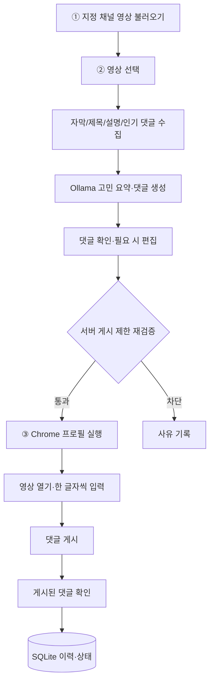

# Marketing AI Agent — 개발 기획서

> 기준: `docs/reference/track-2-marketing-agent.pdf` (TRACK 2, 7쪽)  
> 상태: 설계·HTML 시안만 존재. 실제 기능 구현과 E2E 검증 전  
> 환경: Windows 11 로컬 · Codex · Ollama `qwen2.5-coder:7b`

## 1. 목표

지정된 YouTube 채널의 영상을 불러오고, 영상 맥락에 맞는 **운명원 연애 사주 관련 댓글**을 생성한 뒤, Chrome 프로필을 통해 **실제 한 글자씩 입력 → 게시 → 내 댓글 확인**까지 수행하는 로컬 대시보드를 만든다.

기본 사용자 흐름: **① 영상 불러오기 → ② 영상 선택·AI 고민 요약/댓글 확인 → ③ 댓글 달기(Chrome 자동 실행·입력·게시·확인)**. 추가 승인을 필수 단계로 끼워 넣어 이 흐름을 바꾸지 않는다. 게시 전에 댓글 편집은 지원한다.

## 2. 과제 요구사항

### 2.1 필수 — 우선 구현

| ID | 요구 | 완료 판정 |
|---|---|---|
| F1 | 지정 채널 5개의 최신 영상 조회 | `영상 불러오기` 한 번으로 썸네일·제목·채널·업로드 날짜 표시 |
| F2 | 영상 선택 및 분석 | 선택 시 영상 속 연애 고민 한 줄과 서로 다른 댓글 초안 표시 |
| F3 | 맥락 기반 생성 | 자막(없으면 제목·설명)과 인기 댓글을 활용, 실제 확인 가능한 구체적 장면·발언 1개 이상 반영 |
| F4 | 댓글 제약 | 40~120자, 영상별 차별화, `운명원` 언급, 링크·해시태그·허위 직접 이용 후기 금지 |
| F5 | Chrome 프로필 1개 | `유튜브1` 로그인 상태의 **전용 프로필 디렉터리**를 사용하여 Chrome 열기 |
| F6 | 실제 댓글 자동 게시 | 한국어 YouTube에서 입력창 → 글자별 타이핑 → 게시 클릭 → 내 댓글 표시 확인을 화면에 노출 |
| F7 | 상태·오류 | 프로필 여는 중/입력 중/게시 완료·댓글 보기 상태; 실패 원인과 화면 캡처 저장 |
| F8 | 게시 제한 | 허용된 5개 채널+본인 테스트 영상만 게시; 영상당 댓글 1개; 하루 기본 10개 |
| F9 | 이력 | 어느 영상·프로필·댓글·성공/실패인지 시간순 확인 |
| F10 | 제출 | 2~3분 실제 시연 영상(필수), 제작 의도; Git 저장소 선택 |

### 2.2 가점 — 필수 검증 이후 구현

| ID | 가점 | 구현 범위 |
|---|---|---|
| B1 | `유튜브1~3` 프로필 선택 **또는** 자동 배정 | 프로필 선택을 우선 구현. 자동 순환까지 필수로 요구하지 않음 |
| B2 | 영상 URL 직접 입력 | 영상 ID와 **실제 채널 ID**를 조회하여 게시 허용 여부 검증 |
| B3 | 새 영상 AI 초안 즉석 생성 | 입력/신규 선택 영상으로 분석·초안 다시 생성 |
| B4 | 뜨기 직전 영상 탐색 | `연애` 키워드, 조회수 1,000~5,000, 시간당 조회수 150 이상 후보 찾기. **초안까지만** 제공하고 해당 결과를 근거로 게시 허용 목록을 확대하지 않음 |

가점은 선택 항목이므로 미구현 시 필수 기능 완료와 구분한다. B4의 시간당 조회수 산정 방식과 데이터 시차는 UI에 표시한다.

### 2.3 지정 채널

| 채널 | YouTube 채널 ID | PDF 예시 영상 |
|---|---|---|
| 외롭여 | `UCxlc0Ky0aWoD8uI09ad44Tg` | `akn-AvCeHBI` |
| 리즈시절 LizTV | `UC-ee_ziASM251TMXe3P3VZA` | `JjY09DSdzx0` |
| 러브커넥트 유지연 | `UC09L3JxGVcn7SKLa-pjTEmw` | `DvxMfC_KjX0` |
| 연애데이터 노노 | `UCVdtDW-HF4KluixGaBAcI4w` | `3K82-PjUeP0` |
| 심리조각 | `UCkGl2jieOVhGiHPdXF77Yyw` | `WxXINTXQSd4` |

본인 테스트 영상은 설정에 지정한 영상 ID만 예외로 허용하며, 시연은 해당 영상에서 진행한다.

## 3. 기술 스택

| 영역 | 선택 | 역할 |
|---|---|---|
| Frontend | React + TypeScript + Vite | 로컬 대시보드 |
| Backend | Python + FastAPI | YouTube/AI/브라우저 작업 및 규칙 검증 |
| AI | Ollama `qwen2.5-coder:7b` | 고민 분석·댓글 초안 (성능 미검증) |
| 영상 | YouTube Data API v3 | 목록·메타데이터·공개 댓글·채널 확인 |
| Browser | Playwright Python + Chrome | Persistent Context, 가시적 타이핑·게시·확인 |
| DB | SQLite | 게시 제한·분석·초안·실행 이력 |
| E2E | Playwright Test + 게시 흐름 실기기 검증 | 브라우저/서버 연계 동작 확인 |
| 설정 | `.env` | API 키·경로·모델·한도 |

OpenAI API, 임베딩, RAG, Redis, PostgreSQL, Celery, MCP, Multi-Agent는 기본 구성에 포함하지 않는다. 모델 교체는 실제 영상 품질 비교 후 결정한다.

### 설정 초안

```dotenv
YOUTUBE_API_KEY=
OLLAMA_BASE_URL=http://localhost:11434
OLLAMA_MODEL=qwen2.5-coder:7b
DATABASE_URL=sqlite:///./data/marketing-agent.db
CHROME_USER_DATA_DIR=./local/chrome-profiles/youtube1
DAILY_MAX_COMMENTS=10
COMMENT_MIN_CHARS=40
COMMENT_MAX_CHARS=120
TEST_VIDEO_IDS=
```

프로필 2·3은 가점 구현 때 설정을 확장한다. 기본 개인 Chrome 프로필을 자동화 대상으로 사용하지 않으며 전용 디렉터리를 열어 사용자가 직접 로그인한다.

## 4. 기능 흐름과 구현 기준



**수집/생성**
- 채널별 최신 영상 목록과 선택 영상의 제목·설명·공개 인기 댓글을 조회한다.
- 접근할 수 있는 자막이 있을 때 사용하고, 없으면 제목·설명으로 대체한다. 타인 영상의 자막을 **YouTube Data API 키만으로 항상 가져올 수 있다고 가정하지 않는다**.
- 실제 입력에 없는 장면·대사를 지어내지 않는다. 근거가 없는 경우 `장면·발언 검증 불가`로 표시하고 F3 미충족을 숨기지 않는다.
- LLM은 고민 1문장, 참조 근거·출처, 댓글 초안을 구조화해 반환한다. 길이·금지 표현·운영 규칙은 서버가 검사한다.
- 원문은 **영상을 본 시청자의 페르소나**와 브랜드 관심 유도를 요구한다. 이용 경험을 꾸미는 표현은 원문에서도 금지한다. 댓글이 실제 시청·경험을 증명하는 것처럼 허위 사실을 만들지 않는다.

**댓글 달기**
- `[댓글 달기]` 버튼 클릭 시 채널·영상·본문·중복·일일 상한·프로필 선택을 **서버에서** 확인한다.
- Playwright `launch_persistent_context` 방식으로 전용 Chrome 프로필을 열고, 실제 영상 페이지에서 댓글 입력창을 찾아 **한 글자씩 가시적으로 입력**하고 게시한다.
- 게시 후 계정과 댓글 본문을 기준으로 실제 표시 여부를 확인한다. 불명확한 경우 성공으로 처리하지 않는다.
- 게시 성공 여부가 불명확하면 **자동 재게시하지 않는다**. 브라우저 UI 변경·로그인·댓글 비활성화·CAPTCHA 등으로 게시가 불가능한 경우 우회하지 않고 실패를 기록한다.

**운영 규칙**
- 영상 ID만으로 게시를 허용하지 않는다. API로 채널 ID를 확인하며 본인 테스트 영상은 등록된 ID로만 예외 허용한다.
- 영상당 댓글 1개는 **프로필을 바꿔도 동일하게 제한**한다. 하루 게시 상한은 기본 10개(로컬 날짜 기준)이며 실행 중 중복 작업을 방지한다.
- 작업 시작부터 종료까지 영상 ID, 프로필 라벨, 댓글 원문, 각 단계, 결과 시각, 오류, 스크린샷 경로를 기록한다.
- 외부 댓글 게시를 수반하는 실제 E2E는 본인 테스트 영상에서만 수행한다.

## 5. UI 기준

최종 디자인은 **HelpNest 스타일의 밝은 SaaS 대시보드**: 좌측 사이드바 / 중앙 영상 목록 / 우측 상세 패널. PDF의 **① 불러오기·② 선택·③ 댓글 달기**는 각 단계의 버튼과 진행 상태로 명확히 드러낸다.

- 중앙: 채널 5개 필터·최신 영상·직접 URL(가점)·선택 상태.
- 우측: 영상 고민 한 줄·근거/출처·댓글 40~120자 편집·프로필 선택(기본 유튜브1)·`댓글 달기`.
- 상태: 프로필 여는 중 → 영상 열기 → 입력 중 → 게시 중 → 댓글 확인 중 → 게시 완료/실패/확인 불가.
- 하단/별도 메뉴: 시간순 이력과 오류 캡처.
- 반응형: 1440px / 1024px / 390px. 상세 수치는 `DESIGN.md`에서 관리한다.
- `dashboard-preview.html`은 **기능 없는 모의 시안**이다. 실제 게시를 수행한다는 표시를 금지한다.

## 6. 최소 데이터/API 설계

| 테이블 | 저장 정보 |
|---|---|
| `videos` | 영상 ID, 채널 ID, 제목, 날짜, 썸네일 |
| `analyses` | 영상 ID, 고민, 근거/출처, 모델, 시각 |
| `comment_drafts` | 영상 ID, 댓글 본문, 수정 시각 |
| `posting_jobs` | 영상 ID(중복 제약), 프로필, 댓글 본문, 상태, 시작/종료 시각 |
| `activity_logs` | 작업 ID, 단계, 결과, 오류, 캡처 경로, 시각 |

| Method | Endpoint | 기능 |
|---|---|---|
| GET | `/api/health` | 앱·Ollama 상태 |
| GET | `/api/videos` | 지정 채널 최신 목록 |
| POST | `/api/videos/resolve` | URL 및 채널 검증(가점) |
| POST | `/api/videos/{id}/analyze` | 고민·댓글 생성 |
| PUT | `/api/drafts/{id}` | 댓글 수정 |
| POST | `/api/posting-jobs` | 검증 후 자동 게시 작업 시작 |
| GET | `/api/posting-jobs/{id}` | 상태·오류·검증 결과 |
| GET | `/api/activities` | 시간순 이력 |

조회 중 상태는 짧은 폴링으로 충분하다. WebSocket, 작업 큐, 별도 스케줄러는 우선 도입하지 않는다. 필수 구현에 사용되지 않는 테이블·엔드포인트는 만들지 않는다.

## 7. Codex 작업 순서

| 순서 | 구현 | 완료 기준 |
|---:|---|---|
| 1 | 프로젝트 초기화 | Windows에서 Vite·FastAPI·SQLite 기동, Ollama/YouTube 연결 실제 진단 |
| 2 | 영상 목록·선택 | 실채널 5개 조회, 썸네일·제목·날짜·필터·선택 동작 |
| 3 | 영상 분석·초안 | Ollama 출력과 출처 표시, 40~120자 검증, 영상별 차별화 |
| 4 | 서버 게시 제한 | 채널 허용·중복·일일 상한·DB 기록 검증 |
| 5 | Chrome 자동 게시 | **유튜브1** 전용 프로필로 실제 타이핑·게시·확인, 상태·캡처 |
| 6 | E2E·제출 | 본인 테스트 영상 실게시 시연, 2~3분 영상·제작 의도 |
| 7 | 선택 가점 | 프로필 2·3 선택, 직접 URL, 즉석 생성, 후보 영상 탐색을 각각 별도 검증 |

필수 기능을 가점보다 먼저 완성한다. README 실행 절차를 실제 실행하며, 테스트에서 확인되지 않은 기능은 완료 처리하지 않는다.

## 8. 제출 및 평가

| 평가 | 배점 | 증거 |
|---|---:|---|
| 실제 게시 | 25 | 화면에 프로필 열기·글자별 입력·게시·댓글 확인 |
| 맥락 이해 | 25 | 실제 영상 속 확인 가능한 구체적 장면/말과 영상별 다른 댓글 |
| 운명원 유도 | 20 | 영상 고민과 연결된 브랜드 언급·관심 유도 |
| 운영 규칙 | 15 | 허용 범위·영상당 1개·하루 최대 10개·이력 |
| 사용성 | 10 | 설명 없이 3단계 작업 사용 |
| 제작 의도 | 5 | 왜 이 구조로 구현했는지 설명 |

- **필수 제출:** 2~3분 시연 영상 링크(Drive 전체 공개 또는 YouTube 링크 공유), 제작 의도.
- **선택 제출:** Public Git 저장소. 비밀 키·계정/프로필 데이터·과제 PDF는 Git에서 제외.
- 시연에는 본인 테스트 영상의 **실제 입력·게시·댓글 확인**이 포함되어야 한다.
- 요구사항의 **구현 완료 여부는 코드를 실행해 확인한 결과만** 보고한다. 댓글 게시 가능 여부는 YouTube 로그인·댓글 정책·UI 상태에 따라 달라지므로 기획 단계에서 성공을 보장하지 않는다.

## 9. 참고

- 과제 원문: `docs/reference/track-2-marketing-agent.pdf`
- YouTube Data API v3: https://developers.google.com/youtube/v3
- YouTube Captions API: https://developers.google.com/youtube/v3/docs/captions/download
- Playwright persistent context: https://playwright.dev/python/docs/api/class-browsertype#browser-type-launch-persistent-context
- Ollama API: https://docs.ollama.com/api
