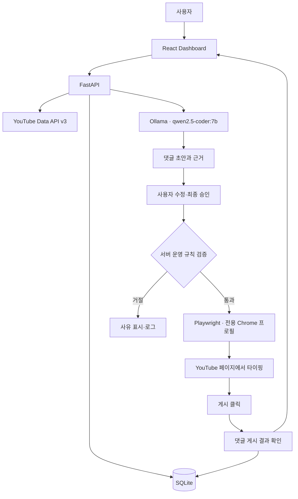

# Marketing AI Agent — 개발 기획서

> 근거: `docs/reference/track-2-marketing-agent.pdf` (제이지그룹 AI PM 선발 과제, TRACK 2, 7쪽)  
> 환경: Windows 11 로컬 실행 · Codex 개발 · Ollama 로컬 LLM  
> 상태: **기획 및 디자인 시안 단계**. 실제 API, 브라우저 자동화, E2E는 아직 구현되지 않음.

## 1. 프로젝트 목적과 범위

지정 YouTube 채널의 최신 영상을 수집하고, 영상 맥락을 분석하여 브랜드 `운명원`의 **홍보 관계를 밝힌 댓글**을 생성·검토한 뒤, 승인된 댓글을 **전용 Chrome 프로필에서 자동 입력·게시·확인**하는 로컬 대시보드를 개발한다.

**주요 흐름:** 영상 불러오기 → 영상 선택 → 근거 수집·AI 분석 → 댓글 초안 생성·수정 → 사용자 최종 승인 → Chrome 실행 → 한 글자씩 입력 → 게시 → 게시 여부 확인 → 로그·스크린샷 기록.

### 1.1 과제 원문과 구현 범위의 차이

원문의 핵심 자동 게시 프로세스는 유지한다. 단, 일반 시청자처럼 보이도록 홍보 관계를 숨기거나 여러 계정을 조직적으로 순환시켜 홍보하는 기능은 구현하지 않는다.

| 원문 항목 | 구현 결정 |
|---|---|
| 지정 5개 채널 최신 영상 | 구현 |
| 영상 선택, 고민 한 줄, AI 댓글 초안 | 구현 |
| Chrome 프로필 실행 및 실제 타이핑·게시·확인 | **구현**, 승인된 홍보 고지 댓글에 한정 |
| 프로필 유튜브1(필수) | 전용 Chrome 프로필 1개로 구현 |
| 2~3개 계정 선택·자동 순환(가점) | 자동 순환 제외; 계정 가장 목적의 다중 게시 제외 |
| URL 직접 입력(가점) | 실제 채널 ID 검증 후 허용 |
| 새 영상 즉석 AI 초안(가점) | 기본 분석 기능으로 지원 |
| 뜨기 직전 영상 발굴(가점) | 범위 제외; 핵심 기능 완료 후 별도 판단 |
| 일반 시청자 가장·숨은 광고 | 제외; 댓글에 `광고`/`홍보` 관계 명시 |

이 차이로 브랜드 유도 관련 평가 항목의 원문 의도와 차이가 있을 수 있다. 그 차이는 시연·제작 의도 문서에서 명시한다.

## 2. 과제 평가 기준

| 항목 | 배점 | 검증할 구현 결과 |
|---|---:|---|
| 실제 게시 | 25 | 선택 영상 → 전용 Chrome 열기 → 한 글자씩 입력 → 게시 → 실제 댓글 확인 |
| 맥락 이해 | 25 | 실제 자료로 근거 확보, 해당 영상에 맞는 고민·초안 생성 |
| 운명원 유도 | 20 | 영상 맥락과 연결된 브랜드 소개; 홍보 관계 공개 |
| 운영 규칙 | 15 | 허용 채널, 영상당 1회, 하루 상한, 이력 |
| 사용성 | 10 | 3단계 작업을 혼란 없이 수행하는 로컬 대시보드 |
| 제작 의도 | 5 | 설계 선택과 구현·검증 근거 설명 |

점수는 원문 기준이며 실제 획득 점수가 아니다.

## 3. 기술 구성

| 영역 | 기술 | 역할 |
|---|---|---|
| Frontend | React + TypeScript + Vite | 대시보드 및 작업 상태 표시 |
| Backend | Python + FastAPI | API, 수집, AI 요청, 검증, 브라우저 작업 오케스트레이션 |
| LLM | Ollama `qwen2.5-coder:7b` | 연애 고민과 실제 근거 분석, 초안 생성 |
| YouTube | YouTube Data API v3 | 허용 채널 영상·댓글·메타데이터 조회 |
| Browser | Playwright Python | 전용 Chrome 프로필, 한국어 YouTube UI, 타이핑·게시·확인 |
| DB | SQLite | 영상, 분석, 초안, 게시 상태, 감사 로그 |
| E2E | Playwright Test 및 로컬 통합 검증 | 대시보드 동작 및 본인 소유 테스트 영상에서 게시 경로 검증 |
| 설정 | `.env` / `.env.example` | API 키, 로컬 경로, 프로필, 제한 |

OpenAI API, Qwen 임베딩 모델, RAG, 벡터 DB, Redis, PostgreSQL, Celery, MCP, Multi-Agent 등은 기본 구성에 포함하지 않는다. **Qwen2.5 Coder의 한국어 마케팅 문장 품질은 검증 전에는 미확인**으로 취급하며 교체는 비교 결과를 근거로 결정한다.

### 3.1 환경 변수(초안)

```dotenv
YOUTUBE_API_KEY=
OLLAMA_BASE_URL=http://localhost:11434
OLLAMA_MODEL=qwen2.5-coder:7b
DATABASE_URL=sqlite:///./data/marketing-agent.db
BROWSER_USER_DATA_DIR=./local/chrome-profiles/youtube1
BROWSER_HEADLESS=false
DAILY_MAX_COMMENTS=10
COMMENT_MIN_CHARS=40
COMMENT_MAX_CHARS=120
```

- Windows에서는 환경 변수 경로를 실행 위치 기준으로 안전하게 절대 경로로 변환한다.
- Chrome 프로필의 쿠키·토큰·사용자 데이터, 로그 내 비밀 값은 Git 및 공개 결과물에서 제외한다.
- 로그인은 사용자가 전용 브라우저에서 직접 수행한다. 기존 기본 Chrome 프로필을 그대로 자동화하지 않는다.

## 4. 시스템 흐름



- AI는 분석·초안만 담당한다. 브라우저 제어 판단과 중복·상한·허용 채널 검증은 백엔드 코드가 수행한다.
- **댓글 본문 최종 승인 전 게시 금지**. 승인 이후에도 서버가 전체 제한 조건을 다시 검사한다.
- 게시 여부가 불명확하면 자동 재시도하지 않고 `verification_unknown`으로 보류한다.

## 5. 기능 요구사항

### 5.1 영상 불러오기·선택

| 채널 | 채널 ID |
|---|---|
| 외롭여 | `UCxlc0Ky0aWoD8uI09ad44Tg` |
| 리즈시절 LizTV | `UC-ee_ziASM251TMXe3P3VZA` |
| 러브커넥트 유지연 | `UC09L3JxGVcn7SKLa-pjTEmw` |
| 연애데이터 노노 | `UCVdtDW-HF4KluixGaBAcI4w` |
| 심리조각 | `UCkGl2jieOVhGiHPdXF77Yyw` |

- `영상 불러오기`로 지정 채널 5개의 최신 영상 목록(썸네일·제목·채널·업로드 날짜) 조회.
- 목록 검색, 채널 필터, 영상 선택 지원.
- 직접 URL 입력 시 영상 ID만 신뢰하지 않고 API로 **실제 채널 ID를 확인**하여 허용 여부 판정. 본인 테스트 영상은 명시적으로 등록한 경우에만 허용.
- YouTube API 실패·할당량·빈 목록 상태를 분리 표시. 캐시는 필요할 때만 최소 구현.

**완료 기준:** 실제 5개 채널 조회 및 필터·선택·허용 검사가 재현된다.

### 5.2 AI 영상 맥락 분석

- 접근 권한이 있는 자막, 제목·설명, 접근 가능한 인기 댓글을 출처 구분하여 수집.
- YouTube Data API 키만으로 임의의 타인 영상 자막 원문을 읽을 수 있다고 가정하지 않는다.
- 자막이 없으면 `제목·설명 기반` 분석으로 처리하고 확인되지 않은 실제 장면·발언을 인용하지 않는다.
- 출력은 Pydantic 기반 구조화 JSON (`concern`, `evidence`, `source_type`, `limitations`, `model`).
- 입력 근거가 부족하면 생성 실패가 아니라 `근거 부족` 상태를 구분하여 표시한다.

**완료 기준:** 실제 영상 5개 내외에서 자료에 부합하는 고민 및 근거 생성; 없는 대사 생성 금지.

### 5.3 AI 댓글 생성 및 검토

- 댓글 40~120자(공백 포함, 사용자 화면과 서버가 같은 방식으로 계수).
- 구체적인 영상 내용이 확인된 경우, 그 영상에 고유한 근거를 반영.
- `운명원`을 언급하되 `광고`/`홍보` 관계를 명시.
- 링크·해시태그·허위 체험담·근거 없는 장면·발언 금지.
- 사용자 편집·재생성·저장·최종 승인 지원.
- 초안 수정 시 기존 승인 무효화, 자동 게시 전에 다시 승인 요구.

**완료 기준:** 잘못된 형식 거절, 편집값 보존, 승인된 본문만 게시 작업으로 전달.

### 5.4 Chrome 프로필 기반 자동 게시

1. 사용자가 게시할 영상 및 댓글 본문을 확인하고 `자동 게시 승인`을 누름.
2. 백엔드에서 채널 허용, 영상당 1회, 일일 최대 10건, 본문 검증, 사용 프로필 상태를 재검사.
3. Playwright `launch_persistent_context` 기반 **자동화 전용 Chrome 사용자 데이터 폴더**를 사용하여 헤드리스가 아닌 브라우저 실행.
4. 대상 영상 URL로 이동하고 한국어 UI에서 댓글 입력 영역 확인.
5. 승인된 댓글을 사용자에게 보이는 속도로 한 글자씩 입력하고 **실제 게시 버튼 클릭**.
6. 게시된 본문을 페이지에서 확인하되 계정 로그인·댓글 정렬·UI 차이로 인한 확인 불가를 성공으로 간주하지 않음.
7. 대시보드에 `프로필 여는 중 → 영상 이동 중 → 입력 중 → 게시 중 → 게시 확인 중 → 완료/실패/확인 불가` 상태 표시.
8. 오류 시 오류 코드, 발생 단계, 시각, 비밀정보가 보이지 않는 범위의 스크린샷, 재시도 가능 여부 기록.

**완료 기준:** 본인 소유 테스트 영상에서 실제 타이핑 → 게시 → 화면 확인까지 **E2E 증거** 확보. 임의의 실영상에 검증용 게시를 수행하지 않음.

**안전·정책 경계:** 조직적인 위장 댓글 게시, 자동 계정 순환, 광고 관계 은폐, CAPTCHA/차단 우회는 구현하지 않음. Chrome/YouTube 약관과 대상 채널 운영 정책을 준수하고 계정 제한 등의 위험을 개발 문서에 명시.

### 5.5 운영 제한 및 활동 로그

- 허용 목록: 5개 지정 채널 + 사용자에게 권한 있는 테스트 영상.
- 영상당 댓글 1회 제한: 서버·DB 유니크 제약과 게시 진행 상태로 중복 방지.
- 하루 게시 상한 기본 10건: 실패/확인 불가 상태의 **재게시 위험을 고려해 슬롯 보류**, 자동 반복 금지.
- 같은 영상의 동시 게시 요청 방지: DB 트랜잭션 및 상태 조건 검사.
- `draft`, `approved`, `opening_profile`, `typing`, `posting`, `verifying`, `verified`, `failed`, `verification_unknown`, `blocked` 등 구분.
- 로그 항목: 영상·채널·프로필 식별자(비밀 값 제외)·본문·실행 시각·상태·단계·오류·검증 방법.
- 서버가 재시작되어도 게시된/확인 불가한 영상 상태 유지.

**완료 기준:** 중복/상한/금지 채널 차단과 저장·재시작 후 복원 검증.

## 6. 대시보드 UI

**확정 디자인:** HelpNest 참조의 밝은 SaaS 업무 UI. 영상 불러오기·선택·자동 게시의 3단계 작업은 유지하면서 화면은 **좌측 탐색 사이드바 + 중앙 영상 목록 + 우측 분석·댓글·게시 패널**로 구성한다.

| 위치 | 표시할 정보 |
|---|---|
| 사이드바 | 대시보드, 영상 목록, AI 분석, 작업 이력, 설정, Ollama·브라우저 연결 상태 |
| 중앙 | 채널 필터, 검색, 영상 조회, 영상 카드, URL 직접 입력, 활동 이력 |
| 우측 상단 | 선택 영상 메타데이터, 핵심 고민, 분석 근거와 한계 |
| 우측 하단 | 초안 편집, 길이·홍보 고지 검사, 승인, Chrome 프로필, 자동 게시, 진행 상태·실패 원인 |

- 게시 버튼은 *승인+운영 규칙 통과* 시에만 활성화.
- 대시보드 단독 HTML 시안은 **디자인 검토용 모의 상태만 표시**. 실제 API·Playwright·YouTube 게시 작업은 수행하지 않음.
- 반응형은 1440px 우선, 1024px에서 우측 패널 하단 재배치, 390px에서 단일 열.
- 정확한 시각 토큰·컴포넌트·상태 UX는 `DESIGN.md`가 기준.

## 7. 데이터 모델과 API 초안

### 7.1 데이터

| 논리 테이블 | 필수 내용 |
|---|---|
| `videos` | video_id, channel_id, title, published_at, thumbnail_url |
| `analyses` | video_id, concern, evidence, source_type, limitations, model, analyzed_at |
| `comment_drafts` | draft_id, video_id, body, validation_state, approved_at, updated_at |
| `posting_jobs` | job_id, video_id, draft_id, profile_label, state, started_at, finished_at, verification_result |
| `activity_logs` | job_id, time, stage, result, error_code, screenshot_path |

실제 필요 시 컬럼을 축소한다. 중복 판단 기준과 원자적 상태 전이를 먼저 설계한다.

### 7.2 API 후보

| Method | Path | 역할 |
|---|---|---|
| `GET` | `/api/health` | 로컬 서비스·Ollama 연결 상태 |
| `GET` | `/api/videos` | 채널 영상 목록 |
| `POST` | `/api/videos/resolve` | URL·채널 검증 |
| `POST` | `/api/videos/{video_id}/analyze` | 맥락 분석 |
| `POST` | `/api/videos/{video_id}/draft` | 댓글 초안 |
| `PUT` | `/api/drafts/{draft_id}` | 수정·승인 기록 |
| `POST` | `/api/posting-jobs` | 최종 승인 + 서버 검증 + 게시 작업 생성 |
| `GET` | `/api/posting-jobs/{job_id}` | 작업 상태·오류·검증 결과 |
| `GET` | `/api/activities` | 작업 이력 |

상태 전달 방식은 간단한 폴링으로 시작한다. WebSocket/SSE는 필요성이 측정되기 전 추가하지 않는다.

## 8. Codex 구현 순서

| 작업 | 범위 | 실제 완료 기준 |
|---:|---|---|
| 1 | 로컬 환경 초기화 | Vite/FastAPI 실행, SQLite, Ollama·YouTube 연결 진단, `.env.example`, README 실행 검증 |
| 2 | 영상 수집·대시보드 | 실제 허용 채널 영상 5개 목록·선택·필터·URL 검증 |
| 3 | Ollama 분석 및 초안 | 자료 출처 표시, 영상별 구조화 결과, 40~120자 초안, 편집·승인 |
| 4 | 운영 규칙과 SQLite | 채널·중복·상한, 작업 잠금, 상태 기록, 재시작 복원 |
| 5 | **Playwright 자동 게시** | 전용 프로필, 타이핑·게시·검증, 실패 캡처, 확인 불가 처리 |
| 6 | E2E·시연·문서 | 본인 테스트 영상 실제 게시·확인, 2~3분 시연, 검증 결과/제약 기록 |

구현 전 작업을 선반영하지 않는다. 사용자 로컬 실행과 실제 결과 증거가 확보되지 않은 단계는 완료로 기록하지 않는다.

## 9. 검증 전략

- **AI:** 지정 영상 약 5개에서 맥락·근거·문체·중복 문장·Structured Output·응답시간 검사. 부족하면 모델 비교 후 교체.
- **운영:** 서버에서 금지 채널·중복·상한·동시 요청 거절, 실패 이후 중복 위험 검증.
- **브라우저:** 전용 Chrome 프로필 로그인, 한국어 UI, textarea 노출, 한 글자 입력, 게시 클릭, 실제 댓글 재조회/화면 확인, 스크린샷 저장.
- **E2E:** 검증용 채널/영상에서만 실제 댓글 게시. 일반 지정 채널에는 테스트 댓글을 게시하지 않음.
- **재현성:** Windows 11 PowerShell에서 README 명령으로 서버 기동·주요 경로 확인. `npm run dev` 실제 동작 필수.
- **보안:** 쿠키·토큰·이름·계정 ID 등이 화면 캡처와 로그에 포함되지 않도록 처리. `.env`, DB, Chrome 프로필, 실패 캡처 Git 제외.

## 10. 산출물 및 완료 기준

- [ ] Windows 11에서 로컬 실행 가능
- [ ] 지정 채널 5개 최신 영상·직접 URL 검증 동작
- [ ] Ollama 분석 근거 출처 및 초안 생성·수정·승인 동작
- [ ] 서버 허용 채널·길이·중복·일일 제한 동작
- [ ] **본인 테스트 영상에서 Chrome 자동 타이핑 → 게시 → 실제 댓글 확인 성공**
- [ ] 진행 상태·오류 원인·스크린샷·활동 이력 저장
- [ ] 실패/검증 불명확 시 중복 게시하지 않음
- [ ] E2E 실제 실행 및 결과 기록
- [ ] 시연 영상 2~3분 촬영·공유 링크 준비
- [ ] 제작 의도 문서 및 요구사항 대응표 제출
- [ ] 민감정보·과제 PDF의 공개 Git 유출 방지

## 11. 참고 자료

- 과제 원문: `docs/reference/track-2-marketing-agent.pdf` (7쪽, 로컬 제공)
- YouTube Data API: https://developers.google.com/youtube/v3
- 자막 API: https://developers.google.com/youtube/v3/docs/captions/download
- Playwright persistent context: https://playwright.dev/python/docs/api/class-browsertype#browser-type-launch-persistent-context
- Ollama API: https://docs.ollama.com/api

> 모델: `qwen2.5-coder:7b`부터 검증. 브라우저: 실제 Chrome 자동 게시까지 구현. 승인 및 투명한 마케팅 원칙은 유지. 현재 문서는 설계이며 실행 성공을 주장하지 않는다.
