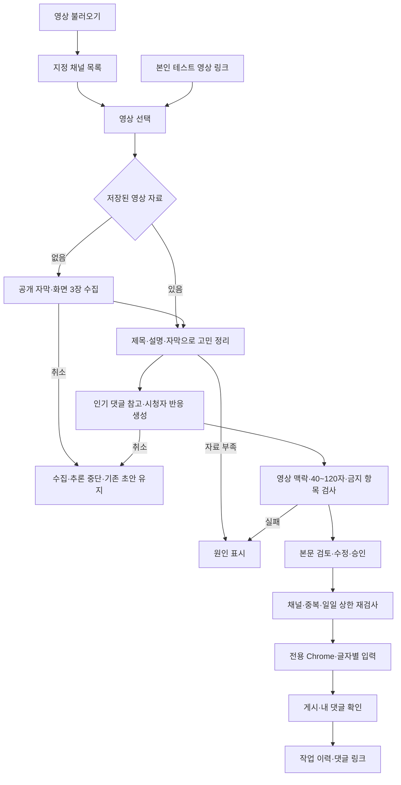

# 시연 영상 촬영안

목표 길이 2분 45초. 화면 순서: 영상 조회 → 내용·댓글 검토 → 본인 테스트 영상 게시 → 게시 결과.

## 촬영 준비

- 앱 주소: `http://127.0.0.1:8000/`
- 화면: 1920×1080 또는 1440×1000, 브라우저 확대 100%, 알림·개인 탭 정리
- 연결: 사이드바의 Ollama·YouTube API·API 확인
- 계정: 환경 설정 → 유튜브1 → 로그인·계정 관리 → 로그인 후 해당 Chrome 창 종료
- 맥락 시연용 영상: [회피형 후폭풍](https://www.youtube.com/watch?v=FBGY7JIM-84) 또는 [신데렐라 연애법](https://www.youtube.com/watch?v=VDflnx7Cn1o)
- 촬영 전 해당 영상 분석 1회 실행, 초·중·후반 3장면·인기 댓글·초안 대조
- 촬영 중 ‘초안 다시 생성’으로 실제 새 추론 시연, 수집 근거 재사용 사실 명시
- 게시용 영상: 아직 댓글을 게시하지 않은 **본인 테스트 영상**의 ID 등록
- 게시 본문: 해당 테스트 영상의 실제 내용에 맞는 40~120자, 직접 검토 후 앱에서 승인

이미 게시된 `DPFhGxGM8qQ`는 재게시 불가. 기존 댓글·중복 방지·게시 이력 유지.
새 촬영용 테스트 영상은 직접 만든 짧은 연애 주제 영상 권장. 음악 영상에는 연애 장면·발언을 지어 넣지 않는 기능 테스트 본문 사용.
등록 변수는 `.env.example`의 `TEST_VIDEO_IDS` 형식 참고. 비밀값·쿠키·로그인 화면의 녹화 제외.

## 촬영 순서·멘트

| 시간 | 화면·클릭 | 확인할 장면 | 짧은 멘트 |
|---|---|---|---|
| 00:00~00:15 | 영상 탐색 → 빈 목록의 **영상 불러오기** | 5채널의 썸네일·제목·채널·날짜 | “지정된 다섯 채널의 최신 영상을 불러옵니다.” |
| 00:15~00:30 | 채널 탭 → 촬영용 연애 영상 선택 | 채널별 목록, 선택된 영상 제목 | “영상 하나를 고르면 내용과 댓글 초안이 나옵니다.” |
| 00:30~00:55 | 핵심 고민 → 화면 3장 → 댓글 | 완결된 고민, 캡처, 그 내용에 반응하는 초안 | “제목·설명과 화면, 인기 댓글을 함께 읽어 시청자의 반응을 만듭니다.” |
| 00:55~01:15 | **초안 다시 생성** | 현재 단계·경과 시간, 실제 새 초안 | “같은 영상의 수집 자료는 재사용하고 댓글은 새로 만듭니다.” |
| 01:15~01:35 | **채널 추가** → 본인 테스트 영상 링크 → **링크 확인** | 실제 테스트 영상의 제목·근거·본문, 유튜브1 선택 | “실제 게시는 제 테스트 영상에서 진행합니다.” |
| 01:35~01:45 | 필요 시 본문 수정 → **수정 저장** → 게시 승인 체크 | 40~120자, 링크·해시태그·허위 이용 후기 없음 | “본문을 확인하고 게시를 승인합니다.” |
| 01:45~02:25 | **댓글 달기** → 열린 Chrome | 댓글 창 → 한 글자씩 입력 → 게시 → 새로고침 후 내 댓글 확인 | “선택한 전용 프로필에서 직접 타이핑하고, 게시 후 댓글까지 확인합니다.” |
| 02:25~02:45 | 앱 **작업 이력** → 해당 작업 → **댓글 보기** | 영상·프로필·본문·시간·최종 상태·댓글 링크 | “영상당 한 번, 하루 열 건 제한과 작업 기록을 서버에서 관리합니다.” |

AI 대기가 길어지면 자료 수집 구간만 배속하고 ‘자료 수집 구간 배속’ 표시. Chrome 입력 시작부터 게시·확인까지는 연속 촬영.
근거를 못 받은 영상은 촬영용으로 사용하지 않으며, 채널 소개 문구를 영상 내용으로 제시하지 않는 기준.

## 화면 배치

1. 대시보드 전체 화면으로 조회·선택 장면 촬영
2. 고민·근거·댓글 구간에서 오른쪽 패널 확대, 문장 끝까지 노출
3. 게시 직전 전체 화면 복귀, 유튜브1과 승인 본문 노출
4. Chrome을 화면 중앙으로 이동, 댓글 입력란·게시 버튼·결과 동시 노출
5. 작업 이력으로 복귀, 성공 상태와 댓글 링크 확인

## 실행 흐름

## 제출 전 확인

- 영상 재생 시간 2~3분
- 조회·선택·Chrome 글자별 입력·게시·내 댓글 확인 포함
- 실제 게시 확인 실패·취소를 성공으로 표시하지 않는 화면
- 촬영용 본문과 실제 게시 본문의 일치
- Google Drive 전체 공개 또는 YouTube 링크 공유 후 로그아웃 창 재생 확인
- 저장소 주소·시연 영상 링크·제작 의도 준비

## 제작 의도 멘트

“영상 내용에 맞는 댓글을 만드는 과정과 실제 게시 과정을 한 화면에서 확인하도록 만들었습니다. 원문과 캡처를 남겨 초안의 근거를 확인할 수 있고, 게시 제한과 기록은 화면 상태와 별개로 서버에서 검사합니다.”
